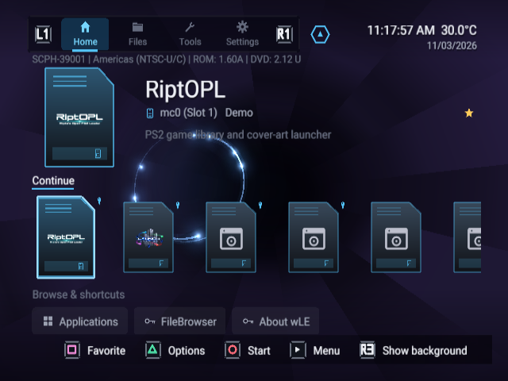
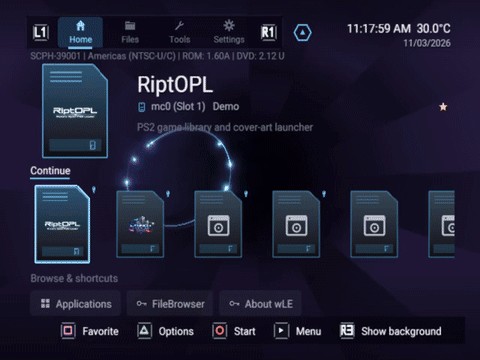

<p align="center">
  
</p>

# Launchstation

**Launchstation** is a PlayStation 2 dashboard, file manager and homebrew launcher based on [wLaunchELF_R3Z](https://github.com/saildot4k/wLaunchELF_R3Z). Browse devices, launch applications and game images, manage saves and card images, and back up MMCE cards locally or to [Google Drive](https://nathanneurotic.github.io/Launchstation/cloud.html) through a controller-driven interface.

## Downloads and project status

[](https://github.com/NathanNeurotic/Launchstation/actions/workflows/compile.yml)
[](https://github.com/NathanNeurotic/Launchstation/releases/tag/latest)
[](https://github.com/NathanNeurotic/Launchstation/releases/tag/latest)
[](https://github.com/NathanNeurotic/Launchstation/releases/tag/latest)
[](https://github.com/NathanNeurotic/Launchstation/releases/tag/latest)

[](docs/THIRD_PARTY_CREDITS.md)


[](https://github.com/NathanNeurotic/Launchstation/blob/download-metrics/metrics/downloads.json)
[](https://github.com/NathanNeurotic/Launchstation/releases/tag/latest)
[](https://github.com/NathanNeurotic/Launchstation/issues)
[](https://github.com/NathanNeurotic/Launchstation/stargazers)


[](https://tinyurl.com/PS2SPACE)
[](https://nathanneurotic.github.io/Launchstation/)
[](https://github.com/NathanNeurotic/Launchstation/wiki)
[](CHANGELOG.md)

> **Download metrics:** *Tracked Downloads* comes from our [persistent per-asset ledger](https://github.com/NathanNeurotic/Launchstation/blob/download-metrics/metrics/downloads.json) (tracking began **2026-11-03**). It preserves observed counts before rolling assets are replaced, but cannot recover older deleted assets or guarantee downloads between snapshots. *Current Release Downloads* counts only the surviving assets on the moving `latest` release. Neither number is a verified all-time unique-user count. See [releases and recovery](docs/wiki/Releases-and-Recovery.md) and [tracking PR #273](https://github.com/NathanNeurotic/Launchstation/pull/273).

[Download](https://github.com/NathanNeurotic/Launchstation/releases/tag/latest) · [User manual](https://nathanneurotic.github.io/Launchstation/) · [Wiki](docs/wiki/Home.md) · [Changelog](CHANGELOG.md) · [Report an issue](https://github.com/NathanNeurotic/Launchstation/issues)

- [Install and update](#install-and-update)
- [Dashboard and controls](#dashboard-and-controls)
- [Features](#features)
- [Supported devices](#supported-devices)
- [Build from source](#build-from-source)
- [Documentation](#documentation)
- [Testing and reporting problems](#testing-and-reporting-problems)
- [Credits and licenses](#credits-and-licenses)

## See Launchstation



**18 built-in theme presets, one dashboard.** These selectable looks are compiled into Launchstation, not separate theme files you have to install. Captured from released build 974 in RIPPCSX2.
The sample applications are non-bootable placeholders; no gameplay is shown.

[All themes and screenshots](https://nathanneurotic.github.io/Launchstation/ui-captures.html) |
[Capture notes](docs/UI-CAPTURES.md).

<details>
<summary>Watch the animated themes (24-second GIF)</summary>



[Full 54-second MP4 tour](docs-site/static/assets/ui/theme-tour.mp4).

</details>

## Install and update

Launchstation needs a console that can already run homebrew, through an existing launcher or exploit. Copying the app to a card or drive does not install a boot exploit.

1. Open the [`latest` release](https://github.com/NathanNeurotic/Launchstation/releases/tag/latest) and choose a package below. The standard app supports PS2 controllers; the **DS34** variant adds PS3/PS4 DualShock USB/Bluetooth support.
2. Extract the app ZIP and copy its folder to a supported device. For a memory-card install, select the matching `.psu` in Launchstation's File Browser and choose **Extract to mc0:/** or **Extract to mc1:/**. Copying the PSU and using **Extract PSU** inside the destination card also works.
3. Launch `LAUNCHSTATION.ELF` or `LAUNCHSTATION-DS.ELF` from your existing launcher. Keep the accompanying files beside it. The included `title.cfg` lets OPL-compatible application lists identify the app.
4. Use **L1/R1** to switch between **Home**, **Files**, **Tools** and **Settings**. In Files, choose a device to start browsing.

### Choose a download

`<build>` is the build number shown in the release title and in Launchstation. Published ZIP names include it; PSU and loose ELF names stay fixed.

| Download | Contents / use |
| --- | --- |
| `APP_LAUNCHSTATION-<build>.zip` | Standard app folder: `LAUNCHSTATION.ELF`, `title.cfg`, `APPINFO.PBT`, `WLE-UPDATE-CA.PEM`, `BGM.ADP`, `icon.sys`, `list.icn`, `copy.icn`, `del.icn`. |
| `APP_LAUNCHSTATION-DS-<build>.zip` | DS34 app folder with `LAUNCHSTATION-DS.ELF` and the same companion files. |
| `APP_LAUNCHSTATION.psu` / `APP_LAUNCHSTATION-DS.psu` | The corresponding app folder in memory-card PSU format. |
| `LAUNCHSTATION.ELF` / `LAUNCHSTATION-DS.ELF` | Packed executables on their own. |
| `BOOT.ELF` / `BOOT2.ELF` | Identical copies of the standard executable for launchers that expect those filenames. |
| `LAUNCHSTATION-<build>.zip` | Optional full kit: the standard app under `APPS/`, its PSU, `POPS/`, `EMBER/`, `neutrino/`, PC-tool shortcuts and a file manifest. |

The full kit packages external loaders alongside Launchstation. Its POPStarter/Ember files come unchanged from a checksum-pinned [RiptOPL](https://github.com/NathanNeurotic/RiptOPL) revision; Neutrino comes from the upstream release. Read [KIT-README.txt](ship/KIT-README.txt) for placement and requirements and the [kit manifest](https://nathanneurotic.github.io/Launchstation/install.html#kit) for versions and checksums. Ember needs your own 512 KB `bios.bin`; POPStarter needs your own `POPS_IOX.PAK` and, where required, `IOPRP.IMG`. Those files, games and signing keys are not included.

**Check the kit's build number:** CI can publish the app even if the optional kit fails to rebuild, leaving an older kit attached to `latest`. The app packages and loose ELFs are the downloads to use for the current app build. Neutrino SMB launching also needs a Neutrino installation containing the SMB modules; the kit manifest records whether its bundled version has them.

`WLE-UPDATE-CA.PEM` supplies trust certificates for HTTPS update checks. `BGM.ADP` is optional background music; omit it for a music-free install. For local or loose-ELF installs, [res/music.sad](res/music.sad) can be copied unchanged beside the ELF as `BGM.ADP`. Interface sound effects are embedded. Both app variants use the same settings format.

### In-app updates and rollback

Open **Settings → Storage & devices → MMCE backups → Check for updates**. The updater offers only a release verified as newer than the running commit, downloads the matching standard/DS34 PSU, checks its digest and executable, and keeps the old executable as `<name>.ELF.BAK`. Restart to use the new build.

Missing certificate/music companion files can be added from a verified package; existing files, including custom music, are preserved. An interrupted `.UPDATE` or `.PACKAGE` file requires inspection before retrying. Older updaters may require a one-time manual install of the complete current app package; retain your settings.

See [Releases, updates and recovery](docs/wiki/Releases-and-Recovery.md) for supported update paths, older-build migration and rollback. Keep a known-good build for your console; `latest` is a rolling release.

## Dashboard and controls

| Tab | Main tasks |
| --- | --- |
| **Home** | Continue, pinned/favorite/recent applications, the Applications library, and Last folder. |
| **Files** | Browse devices and folders; manage files, saves and card images; launch executables and game images. |
| **Tools** | Text Editor and Hex Editor, disc boot, HDD Manager, exploit installer, OPL IGR backup setup, networking, cloud backups and system information. |
| **Settings** | Appearance, applications, sound, input, launching, storage, backups, networking and system options. |

**START** opens the Dashboard menu. **SELECT** changes Grid/List/Carousel in the Applications library. In the File Browser, **Triangle** opens actions and **Square** marks items. Confirm/Back follows the configured X/O preference; a fresh configuration defaults to Circle on Japanese and Chinese consoles and to Cross elsewhere. Follow the on-screen hints for each tool.

The File Browser has four display modes: names, names with details, game titles, and game titles with details. **Type** is the default sort (folders, executables, text, then other files); Name, Game title, Size, Date-Time, Kind and As stored are also available. See [Controls](https://nathanneurotic.github.io/Launchstation/controls.html) and [File Browser](https://nathanneurotic.github.io/Launchstation/file-browser.html).

Storage drivers generally start when needed. **Not checked** means a device has not been probed, rather than proving it is absent. Faulty hardware can still block synchronous device requests; manual USB diagnostics deliberately probe one logical unit at a time.

## Features

### Applications and game images

- Launch ELF applications from the File Browser, library, favorites or configured launch keys; open KELFs from the File Browser. Applications can be hidden from the library or selected to start at boot.
- Pass arguments from a text file, the Text Editor's current buffer or an `<elf name>.arg` sidecar. See [Launch arguments](https://nathanneurotic.github.io/Launchstation/launch-arguments.html).
- Launch **PS2 ISOs through [Neutrino](https://github.com/ps2max32/neutrino)**, with compatibility modes, GSM/video options, debug colors and PS2-logo control. **Save for this game** explicitly stores an optional per-Game-ID profile; ordinary Run leaves edits temporary.
- Launch **PS1 VCDs through [POPStarter](https://www.psx-place.com/threads/popstarter.19139/)**, or **CUE/BIN/EXE images through [Ember](https://github.com/Gageformer/Ember)** under a save-safe `<Ember directory>/games/<Game>/` layout. The selected file format chooses the PS1 loader.
- Configure or discover external loader paths, independently disable each image loader, and optionally send game IDs to [RetroGem](https://www.pixelfx.co/hdmi-retro-gem) or supported MMCE card-selection paths.

The app packages contain Launchstation; game loaders must be installed separately or supplied by the full kit. Launch support depends on the device and loader. SMB ISO launching uses Neutrino's own SMB backend and needs its complete SMB-capable installation on a local device; the full kit's Neutrino (upstream's latest development build, v1.8.0-61-g7be8de2 of 2026-08-31) predates that backend, so it cannot launch SMB ISOs yet. Direct executable/game launching from PC CARD CF is unsupported. See [Game launching](https://nathanneurotic.github.io/Launchstation/game-launching.html) for each loader's files, layouts and limitations.

### Files, saves and card images

- Copy, move, paste with new names, rename, delete, create folders, edit metadata, use bookmarks (PathPad), and create/extract PSU saves.
- Mount VMC images; view PNG/JPG/JPEG images with zoom, rotation and slideshows; edit text and configuration files.
- Manage APA partitions and inject HDD-OSD/PSBBN headers with the [HDD Manager](https://nathanneurotic.github.io/Launchstation/hdd-manager.html).
- Open **Card contents...** on a card image to copy/move/delete saves, export PSU files, signed PS3 `.psv` saves, CodeBreaker `.cbs` saves or a `.zip` of the save folder for a PC, import saves (`.psu`, a Blaze save from the card's `MCM` folder, or a `.mcm`, `.max`, `.cbs`, `.sps`, `.xps` or `.psv` export from another tool), copy to a new card size, or split saves into Game ID cards. **Convert to .psu, .psv, .cbs or .zip...** turns one of those exports into a `.psu`, a PS3 `.psv`, a CodeBreaker `.cbs` or a `.zip`, and a `.psu` into any of the others.
- **Card contents...** also opens PS1 cards (128 KB POPStarter `.VMC`, sd2psx/MMCE cards in PS1 mode, `.mcr`, `.vm1`, RetroArch `.srm`, and DexDrive `.gme`, Connectix `.vgs`/`.mem`, PSP/Vita `.vmp` and PocketStation iOS `.mcx` cards): import `.mcs`, `.psv`, `.psx` or raw PS1 saves, export one as `.mcs`, signed PS3 `.psv`, `.psx` or raw, delete one, or save a copy of the card in another container. **Convert to .mcs, .psv, .psx or raw...** in the File Browser does the same for one PS1 save file, or a save on a real PS1 card in `mc0:`/`mc1:`, without a card image.
- Use **All saves here...** to browse saves across card images in a folder and its immediate subfolders. Mark several saves for batch operations, or export all or the marked ones as `.psu` or `.psv` files into one folder. In the File Browser, mark PS2 saves in `.psu`, `.mcm`, `.max`, `.cbs`, `.sps`, `.xps` or `.psv` format, or files in a Blaze `MCM` folder. **Import into a card image...** imports the marked saves into one PS2 card image; formats can be mixed. **Extract to mc0:/** or **mc1:/** writes them straight onto the memory card in that slot instead.
- Use **Save library here...** to organize PSU files, copy them to a card, save selections as sets and explicitly apply a set. **New blank card...** creates a new 1, 2, 4, 8, 16, 32 or 64 MB image, or an empty PS1 card (a plain image, POPStarter `SLOT0.VMC`/`SLOT1.VMC`, Ember `MC1.vmc`/`MC2.vmc`, PS3 `.VM1`, or a `.gme`, `.vgs`, `.vmp` or `.mcx` card), which then opens to import saves. Mark several PS1 save files and **PS1 card from these saves...** makes such a card holding all of them in one step; copying to a new card size offers the same 1–64 MB choices. Splitting into Game ID cards starts at 8 MB.

Card-image writes start with a verified `WLE-Safety/` copy and read back changes. PCSX2 `.ps2` images are read-only in the card editor; mounted VMCs block card-image writes, and an MMCE card being served to the console is protected. New/resized/Game ID cards and these save-management features still need physical-console validation. See [Saves and card images](https://nathanneurotic.github.io/Launchstation/saves.html#card-contents) for format restrictions and list limits.

### MMCE backups and Google Drive

- Back up MMCE cards to local history as native `.mcd` or PCSX2 `.ps2` images; configure automatic sync and the OPL IGR helper.
- Optionally keep **Per-save versions** as PSU files when individual saves change (Off by default).
- Link Google Drive with a device code, upload missing history over HTTPS, browse cloud history, and download verified card snapshots or individual PSU versions. Official release builds embed the OAuth client; local builds can supply their own.
- Recover snapshots to **new files**. Store a new snapshot outside selectable MMCE card paths, or install a new numbered/Game ID card where the adapter firmware supports it. Existing active cards are never overwritten by recovery.

Automatic IGR backups can skip unchanged cards using a directory fingerprint. After eight consecutive fingerprint skips, the next backup compares the full image; manual all-card backups compare it in full. Adapter card switching is limited to supported numbered cards; BootCard, named and Game ID cards may need the adapter's buttons.

See [MMCE recovery](docs/wiki/MMCE-Recovery.md), [MMCE backups](https://nathanneurotic.github.io/Launchstation/mmce-backup.html) and [Google Drive](https://nathanneurotic.github.io/Launchstation/cloud.html) for setup and safety boundaries.

### Networking and customization

- FTP, [PS2Link](https://github.com/ps2dev/ps2link) and compatible remote ISO transfers start from **Tools → FTP / Remote access**. UDPFS and SMB shares open through Files; network stacks start on demand. Transfers between SMB and UDPFS, or SMB and PC CARD CF, are refused because their device stacks cannot coexist.
- Configure SMB2/SMB3 shares and an optional SMB1 share in Settings > Network > SMB shares (saved in `LAUNCHSTATION.CNF`; an old `SMB2.CNF` is still read); see [Network shares (SMB)](https://nathanneurotic.github.io/Launchstation/smb.html). SMB and Neutrino SMB support remain pending console validation.
- NFSv4.0 exports are NFS shares in the same place (Server type NFS); see [Network shares (NFS)](https://nathanneurotic.github.io/Launchstation/nfs.html). NFS support remains pending console validation.
- Choose from 18 built-in theme presets (no extra theme pack required), custom colors, wallpapers, fonts ([Roboto](https://fonts.google.com/specimen/Roboto), System or [Emotion Engine](docs/font-generation.md)), clocks, icons, Classic/PS2-style sound effects and shareable theme folders. See [Themes](docs/themes.md) and the [wallpaper guide](docs/wiki/Theme-and-Wallpaper-Guide.md).
- Use English, Spanish, Italian, French, German, Polish, Portuguese, Brazilian Portuguese or Hungarian, with optional external `.LNG` overrides. Some extended help remains English; filenames and metadata retain their original text.
- Set a **software clock** under Settings → System or sync the PS2 clock from the Internet under Settings → Network. A saved software-clock checkpoint resumes on restart but cannot account for time spent powered off.
- Install a supported memory-card boot exploit or bind a custom ELF using your own signing material; see the [exploit installer guide](https://nathanneurotic.github.io/Launchstation/exploit-installer.html) for console restrictions and `PS2KEYS.dat` requirements.

## Supported devices

Device entries depend on the build, console and visibility settings. Listing a transport here describes implemented support, not a guarantee for every adapter or hardware combination.

| Device paths | Use / limitations |
| --- | --- |
| `mc0:/`, `mc1:/` | Physical memory cards. Slot 2 access requires switching away from an active MX4SIO stack. |
| `usb:/`, `usbN:/` (legacy `mass:`) | FAT/exFAT USB mass storage. Logical units follow attachment order, not fixed physical ports. |
| `mmce0:/`, `mmce1:/` | MMCE-capable adapters such as SD2PSX, PSxMemCard Gen2 and MemCard PRO 2; firmware capabilities differ. |
| `mx4sio:/` | SD storage in a memory-card port. Switching between MMCE and MX4SIO resets the IOP. |
| `ilink:/` | i.Link/FireWire storage on supported early consoles; hidden on retail ROM 1.70+ and PSX DESR. |
| `hdd0:/`, `ata0:/` | Internal APA/PFS HDD or BDM/exFAT ATA storage. Hidden on Deckard (SCPH-75K+) and PSX; the second unit is hidden by default. |
| `cf0:/` | PC CARD CompactFlash on early Japanese PS2s (ROM 0100/0101/0110/0120). EXFAT builds only; exclusive with DEV9, no direct launches, hardware validation outstanding. |
| `xfrom0:/`, `dvr_hdd0:/` | PSX DESR flash and DVR HDD paths; hidden on other consoles. |
| `cdfs:/` | CD/DVD filesystem. |
| `udpfs:/` | Network storage using [UDPFSD](https://github.com/pcm720/udpfsd). |
| `smb:/<NAME>`, `smb1:/` | Configured SMB2/SMB3 shares and one optional SMB1 share. |
| `nfs:/<NAME>` | Configured NFSv4.0 shares. |
| `host:/` | [PS2Link](https://github.com/ps2dev/ps2link) host filesystem in networking-enabled builds. |

See [Device support](https://nathanneurotic.github.io/Launchstation/devices.html) for probing, firmware requirements and hardware-specific restrictions.

## Build from source

The supported build system is **[PS2BUILD](https://ps2build.dev/)** with [ps2.yaml](ps2.yaml). Release builds use its **[LLVM/Clang](https://clang.llvm.org/)** toolchain for EE and IOP code; the legacy Makefile build has been retired.

Use a full Git checkout so the generated build number matches the commit history. The repository SDK installer targets **Linux x86-64**. Have [Git](https://git-scm.com/), [Bash](https://www.gnu.org/software/bash/), [Python 3.11+](https://www.python.org/), [curl](https://curl.se/), [tar](https://www.gnu.org/software/tar/), [zstd](https://github.com/facebook/zstd), [CMake](https://cmake.org/), [Make](https://www.gnu.org/software/make/), GNU [timeout](https://www.gnu.org/software/coreutils/manual/html_node/timeout-invocation.html) and [setsid](https://man7.org/linux/man-pages/man1/setsid.1.html) available; the SDK supplies the cross-toolchain and PS2 tools. See [Building from source](https://nathanneurotic.github.io/Launchstation/building.html) for the complete workflow and troubleshooting.

Run from the repository root:

```sh
# Install or refresh the SDK versions pinned in .github/ps2build-sdk.env.
export PS2BUILD_ROOT="$HOME/.local/share/ps2build"
sh scripts/ps2build_sdk.sh --llvm "$PS2BUILD_ROOT"
export PATH="$PS2BUILD_ROOT:$PATH"
export PS2BUILD_TOOLCHAIN=llvm

# Build third-party libraries with the same toolchain as the application.
bash scripts/build_cloud_tls.sh   # Mbed TLS -> .cloud-deps/
bash scripts/build_jpeg.sh        # libjpeg-turbo -> .jpeg-deps/
python3 scripts/gen_cloud_client.py
python3 scripts/gen_githash.py --require-git
ps2build build
```

The [SDK installer](scripts/ps2build_sdk.sh) installs the pinned versions from the official [ps2build GitHub releases](https://github.com/ps2build), with a checksum-verified private [mirror](https://github.com/NathanNeurotic/old-ps2build-mirror) fallback. A weekly [watch](.github/workflows/ps2build-sdk-watch.yml) proposes new pins as a draft pull request, so builds never ask the server which release is newest. A private mirror requires read access through `PS2BUILD_SDK_MIRROR_TOKEN`; the official server does not. Rebuild both third-party libraries after changing toolchains or SDK versions.

Outputs include `build/bin/wLaunchELF-packed.elf` (release executable), `build/bin/wLaunchELF.elf` and source-built IOP modules. The standard profile enables networking, SMB, native cloud and the storage integrations above; network services generally start on demand. DS34 is a separate variant:

```sh
python3 scripts/configure_ds34.py
ps2build build -c .ps2-ds34.yaml -o build-ds34
```

[gen_cloud_client.py](scripts/gen_cloud_client.py) accepts `WLE_GOOGLE_CLIENT_ID` and `WLE_GOOGLE_CLIENT_SECRET` together, or neither. Without them the app still builds, but Drive linking needs a custom client in [WLE-CLOUD.CNF](https://nathanneurotic.github.io/Launchstation/configuration.html#cloud-files). [gen_githash.py](scripts/gen_githash.py) with `--require-git` requires full Git history and stamps the build number, commit and date.

For a GCC comparison build, set `PS2BUILD_TOOLCHAIN=gcc`, rebuild the third-party libraries and use a separate output directory (`ps2build build -o build-gcc`). Rebuild those libraries again before returning to LLVM.

### Packaging and CI

[package_apps.py](scripts/package_apps.py) produces four installable archives and four loose ELFs from the standard and DS34 builds. Its local ZIP filenames are `APP_LAUNCHSTATION.zip` and `APP_LAUNCHSTATION-DS.zip`; release CI adds the build-number suffix. The optional full kit uses [package_kit.py](scripts/package_kit.py) and the checksum pins in [ship/kit-externals.json](ship/kit-externals.json).

[Automated-Build](.github/workflows/compile.yml) runs host regression tests, builds the documentation and both controller variants, independently builds the PC CARD CF and PS2IP RPC modules, and checks toolchain purity, controller symbols, UDPFS SMAP compatibility and loader memory layout. Pull requests build and test. Publication to `latest` is restricted to eligible `master` pushes/manual runs, checks that `master` has not advanced, verifies ancestry, and confirms each uploaded app asset against its GitHub-computed SHA-256 digest and byte size without downloading it (CI downloads would inflate the public count). A kit failure can leave the previous kit attached.

## Documentation

| Task | Guide |
| --- | --- |
| Install, update or roll back | [Releases and recovery](docs/wiki/Releases-and-Recovery.md) |
| Learn the dashboard and settings | [Dashboard reference](docs/dashboard.md) · [Settings manual](https://nathanneurotic.github.io/Launchstation/settings.html) |
| Set up game loaders | [Neutrino](https://nathanneurotic.github.io/Launchstation/neutrino.html) · [POPStarter](https://nathanneurotic.github.io/Launchstation/popstarter.html) · [Ember](https://nathanneurotic.github.io/Launchstation/ember.html) |
| Manage saves or recover MMCE backups | [Saves and card images](https://nathanneurotic.github.io/Launchstation/saves.html) · [MMCE recovery](docs/wiki/MMCE-Recovery.md) |
| Configure networking | [Network setup](https://nathanneurotic.github.io/Launchstation/network.html) · [SMB shares](https://nathanneurotic.github.io/Launchstation/smb.html) · [NFS shares](https://nathanneurotic.github.io/Launchstation/nfs.html) |
| Customize the interface | [Themes](docs/themes.md) · [Wallpaper example](docs/wiki/Theme-and-Wallpaper-Guide.md) |
| Find technical references and credits | [Documentation index](docs/README.md) · [Third-party inventory](docs/THIRD_PARTY_CREDITS.md) |

The [website](https://nathanneurotic.github.io/Launchstation/) includes a searchable [guide index](https://nathanneurotic.github.io/Launchstation/wiki.html). Build an offline copy without the PS2 SDK:

```sh
python3 docs-site/build.py --out build/docs --zip build/Launchstation-Documentation.zip
```

Edit [docs-site/](docs-site/) for the website and [docs/wiki/](docs/wiki/) for the maintained Markdown guides. CI publishes the generated site to `gh-pages` and synchronizes managed guides/reference pages to the GitHub Wiki; the wiki must first be initialized. Do not edit generated `gh-pages` output. See [Contributing](https://nathanneurotic.github.io/Launchstation/contributing.html) for the publication workflows.

## Testing and reporting problems

Host tests use [Python 3.11+](https://www.python.org/), [GCC](https://gcc.gnu.org/) and [NumPy](https://numpy.org/); they do not require the PS2 SDK. From the repository root, run an individual script or the complete suite with failure propagation:

```sh
python3 tests/test_self_update.py

# All host test scripts (after installing NumPy in your Python environment).
failed=0
for test_file in tests/test_*.py; do
    python3 "$test_file" || failed=1
done
test "$failed" -eq 0
```

For documentation changes, run:

```sh
python3 docs-site/build.py --out build/docs-site
python3 tests/test_project_branding.py
python3 tests/test_wallpaper_docs.py
```

A successful build or host test does not establish behavior on real PS2 hardware. New save tools, PC CARD CF and SMB/Neutrino SMB paths have outstanding console-validation requirements. Check [Troubleshooting](https://nathanneurotic.github.io/Launchstation/troubleshooting.html) before [filing an issue](https://github.com/NathanNeurotic/Launchstation/issues).

Include the build number and commit (Tools → About Launchstation), standard/DS34 variant, console model/ROM, storage device and firmware, reproduction steps, and the last working build if known. Keep `WLE-CLOUD.TOK`, credential-bearing configuration and `PS2KEYS.dat` out of reports.

## Credits and licenses

Launchstation builds on [wLaunchELF_R3Z](https://github.com/saildot4k/wLaunchELF_R3Z) and the earlier [wLaunchELF, uLaunchELF and LaunchELF lineage](docs/THIRD_PARTY_CREDITS.md#lineage-and-contributors). Thanks to [R3Z3N / Saildot4K](https://github.com/saildot4k) for the upstream foundation and continued work.

[johnson-cooper](https://github.com/johnson-cooper) created and transferred this fork; [NathanNeurotic / Ripto](https://github.com/NathanNeurotic) is its current maintainer. Thanks to [techwritescode](https://github.com/techwritescode), [TnA](https://github.com/TnA-Plastic), [oMrRexD](https://github.com/oMrRexD), [Zackcage](https://github.com/zackcage6), [Fifthfox](https://github.com/fifthfox) and the wider [PS2 homebrew community](https://github.com/ps2dev) for collaboration, testing and feedback.

Build and runtime dependencies include [PS2BUILD](https://ps2build.dev/), [PS2SDK/ps2dev](https://github.com/ps2dev/ps2sdk), [mmceman](https://github.com/ps2-mmce/mmceman), [RiptOPL usbd-ra](https://github.com/NathanNeurotic/Open-PS2-Loader), [ps2ftpd](https://github.com/ps2homebrew/ps2ftpd), [Ronnie Sahlberg](https://github.com/sahlberg)'s [usmb2](https://github.com/sahlberg/usmb2) and [unfs4](https://github.com/sahlberg/unfs4), [DS34 drivers](https://github.com/saildot4k/wLaunchELF_R3Z) including work by [Alex Parrado](https://github.com/parrado), [Mbed TLS](https://github.com/Mbed-TLS/mbedtls), [libjpeg-turbo](https://github.com/libjpeg-turbo/libjpeg-turbo), and the [SDK audio package](https://ps2build.dev/). PC CARD CF draws on [PS2CF](https://github.com/mihhru/PS2CF) by [mihhru](https://github.com/mihhru).

External integrations include [Neutrino](https://github.com/ps2max32/neutrino) by [Rick Gaiser](https://github.com/rickgaiser) and contributors, [POPStarter](https://www.psx-place.com/threads/popstarter.19139/) by [krHACKen](https://www.psx-place.com/members/krhacken.98/), [Ember](https://github.com/Gageformer/Ember) by [Gageformer](https://github.com/Gageformer), [BDM Assault](https://github.com/Okeanos86/BDMAssault) by [israpps](https://github.com/israpps) and [Okeanos86](https://github.com/Okeanos86), [PS2Link](https://github.com/ps2dev/ps2link), [UDPFSD](https://github.com/pcm720/udpfsd), [OSDMenu](https://github.com/pcm720/OSDMenu), [KELFTool](https://github.com/xfwcfw/kelftool), [CosmicScale](https://github.com/CosmicScale)'s [HDD-OSD icon generator](https://github.com/CosmicScale/HDD-OSD-Icon-Generator), [RetroGem](https://www.pixelfx.co/hdmi-retro-gem) and [Google Drive](https://developers.google.com/workspace/drive/api/guides/about-sdk). The full kit bundles selected external programs; the app ELF does not embed those game loaders.

See [Third-party credits and license inventory](docs/THIRD_PARTY_CREDITS.md) for project links, exact roles, bundled/unbundled status and license terms. File-level notices remain authoritative; this repository currently has no single root license covering all components.
