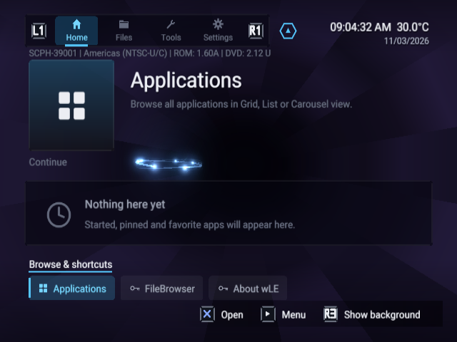

# Launchstation interface captures

This capture collection is in progress. The initial image verifies that released
Launchstation build 974 boots and renders in the isolated RIPPCSX2 lab. It is not
the completed promotional showcase: the Continue row is still empty.

The [capture manifest](../docs-site/static/assets/ui/capture-manifest.json) records
the source revision, released ELF hash, display mode and exact input sequence.
The PNG preserves the native 640 x 480 emulator output. No BIOS, memory-card
image, application binary or personal data is included in the repository.

## Finishing the collection

Capture every built-in theme listed in [Dashboard themes](themes.md), using the
same populated sample library and framing so the views can be compared. Record
short motion clips for the animated backgrounds and library transitions.

Cover Home, all three Applications views, favorites and app details; Files and
its context menu, bookmarks, sorting, image viewer and text editor; Tools and
storage/backup dialogs; settings categories, appearance, theme customization,
network, updates and system information. Stage credentials-free examples for
network and cloud pages. Show hardware-only operations as configuration screens
without implying a successful console operation.

Keep sample files clearly identified. Capture the real UI; use existing matching
artwork where appropriate and record its sources. Inspect every image and clip
before adding it to the README, site home, feature guides and generated wiki.
Refresh all asset hashes and sizes after every take, even with the same ELF.

The open PR description contains the local capture-lab paths, current fixture
issue and detailed continuation instructions. This page and initial image should
be replaced or expanded by the finished gallery before the PR leaves draft.
