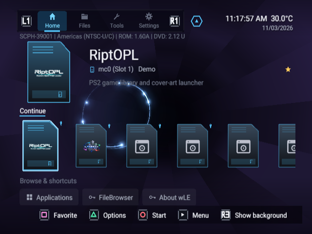

# Launchstation wiki

[Browsable GitHub Pages guide index](https://nathanneurotic.github.io/Launchstation/wiki.html) · [Current releases](https://github.com/NathanNeurotic/Launchstation/releases/tag/latest) · [Repository](https://github.com/NathanNeurotic/Launchstation)

This is the maintained Markdown guide collection stored in the repository. An automated sync publishes these guides and the authored website reference pages to the standalone GitHub Wiki when the Wiki repository is initialized and the publish workflow succeeds. GitHub Pages continues to build from `docs-site/content/` independently.

## See the dashboard

[All 18 themes and feature captures](ui-captures.html), captured in RIPPCSX2 using
non-bootable sample files. [Theme tour MP4](../../docs-site/static/assets/ui/theme-tour.mp4).

## Read by task

1. [Current interface and features](Current-Features.md) — four-tab dashboard, Home/Applications, Files, Tools, Settings, device discovery, core handoffs, backups and languages.
2. [MMCE recovery and safety](MMCE-Recovery.md) — verified local/Drive snapshot selection, new-file recovery and unsupported direct restore.
3. [Releases, updates and rollback](Releases-and-Recovery.md) — standard and DS34 app packages, the optional full kit, how `latest` is published, the in-app updater and rollback.
4. [Themes and wallpaper example](Theme-and-Wallpaper-Guide.md) — 4:3 dimensions, PNG sample, safe-area tips and import instructions.
5. [Third-party credits, origin and licenses](../THIRD_PARTY_CREDITS.md) — all referenced upstream projects, bundled code and external integration roles.
6. [USB stability audit](../../USB-STABILITY-AUDIT-2026-10-08.md) — known risk areas and preserved hardware-tested baseline.
7. [Native Google Drive technical notes](../NATIVE_CLOUD.md) — OAuth/TLS, retention and recovery details.

## Quick facts

- Repository: <https://github.com/NathanNeurotic/Launchstation> · Site: <https://nathanneurotic.github.io/Launchstation/>
- Fork of [wLaunchELF_R3Z](https://github.com/saildot4k/wLaunchELF_R3Z); the dashboard is the only interface.
- Releases: one moving `latest` release built from `master` by CI with the PS2BUILD LLVM/Clang toolchain. App ZIPs are named `APP_LAUNCHSTATION-<build>.zip` and `APP_LAUNCHSTATION-DS-<build>.zip`; matching PSUs and loose ELFs keep fixed names. The optional `LAUNCHSTATION-<build>.zip` full kit adds external game loaders. If a kit build fails, the previous kit stays attached, so compare its build number with the release title.
- History: [CHANGELOG.md](../../CHANGELOG.md) (the Rolling section feeds the release notes).

## Source-of-truth policy

- Website text: `docs-site/content/*.html`, `docs-site/manifest.json`.
- Wiki-style explanations: `docs/wiki/*.md`.
- Package and feature behavior: actual `src/`, `include/`, `iop/`, `ps2.yaml`, `.github/workflows/` and verified Git history.
- Generated `gh-pages` output: **do not edit manually**.
- Hardware reports: identify exact build commit, console model, media transport and whether a behavior was hardware-tested. Passing CI alone does not prove compatibility.

## More reference pages

The site also has detailed guides for [building](https://nathanneurotic.github.io/Launchstation/building.html), [save and card-image tools](https://nathanneurotic.github.io/Launchstation/saves.html), [SMB shares](https://nathanneurotic.github.io/Launchstation/smb.html), [launch arguments](https://nathanneurotic.github.io/Launchstation/launch-arguments.html), [HDD header injection](https://nathanneurotic.github.io/Launchstation/hdd-manager.html) and the [exploit installer](https://nathanneurotic.github.io/Launchstation/exploit-installer.html).
